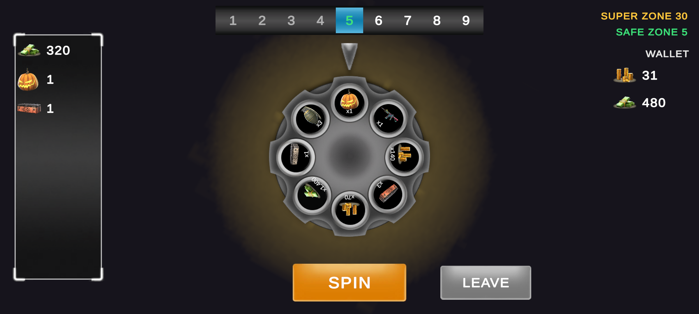
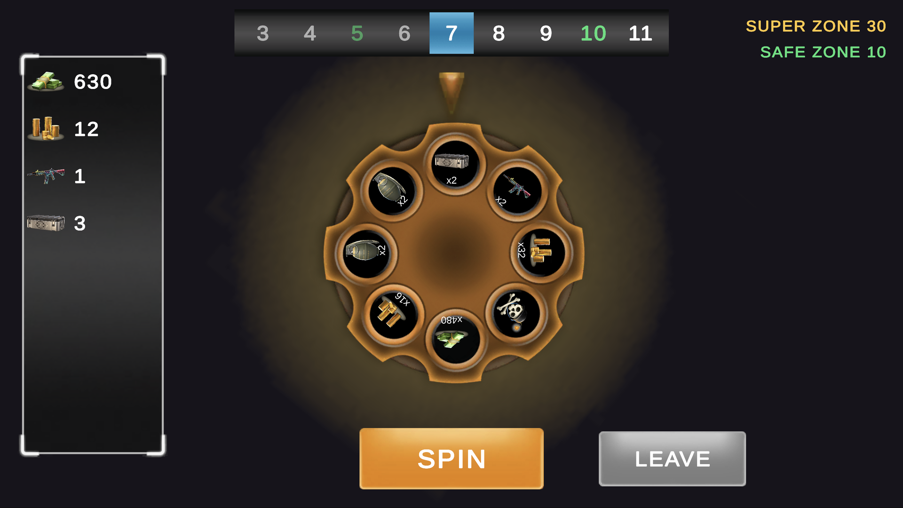
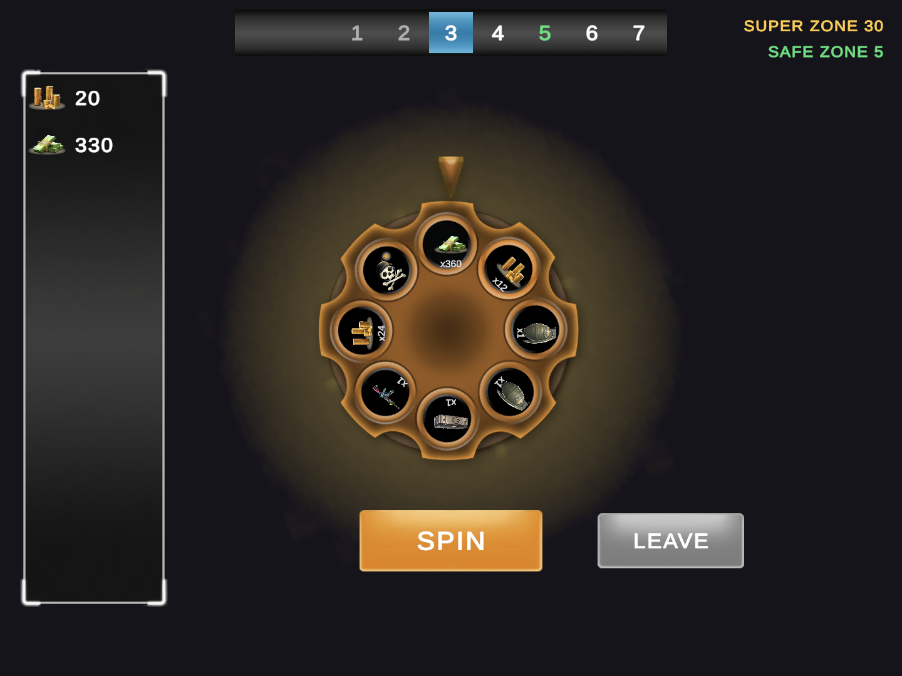
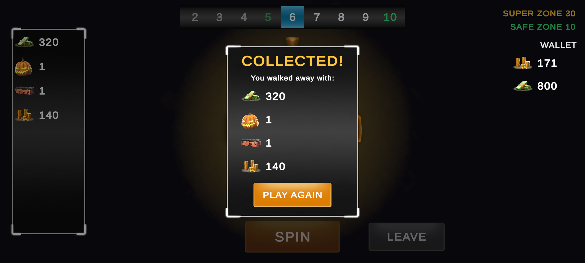
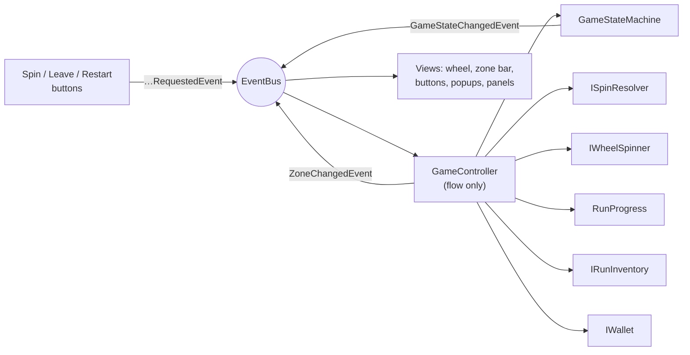
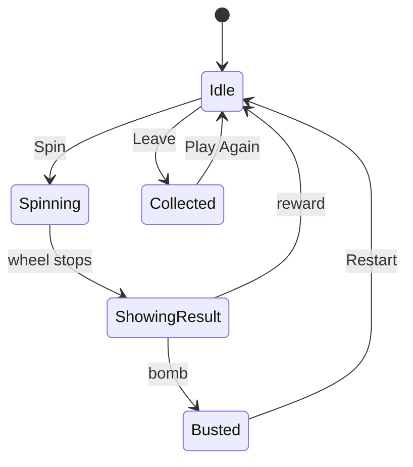

# Vertigo Wheel: Game Developer Demo

A wheel of fortune risk game inspired by Critical Strike's card game, made with **Unity 6000.3.23f1**, C#, DOTween and TextMeshPro. Landscape, for Android.

**APK:** [Release v2.0](https://github.com/sevvaaal/VertigoWheelGame/releases) · **Video:** [`Media/vertigo_gameplay.mp4`](Media/vertigo_gameplay.mp4) (recorded from the Android build)

> **This is the revised version (v2.0).** Every point from the technical review is addressed. See [What changed in this revision](#what-changed-in-this-revision), which follows the review's tables A to F.

| 20:9 | 16:9 | 4:3 |
|---|---|---|
|  |  |  |

All three are the same moment of one Android run (zone 5, a safe zone), captured at the three ratios. After **Leave**, the collected rewards go into the wallet:



## How it plays
- Every zone you spin a wheel with 8 slices: rewards and, on normal zones, exactly one **bomb**.
- A reward is added to the run's rewards panel and you move to the next zone. Rewards get better as the run goes on: **better wheels** unlock at later zones (see [Reward progression](#reward-progression)), and amounts grow +10% per zone.
- **Every 5th zone** is a **safe zone**: a silver wheel without a bomb. **Every 30th zone** is a **super zone**: a golden wheel without a bomb and with special rewards.
- **Bomb:** everything collected in this run is lost. **Restart** starts again from zone 1.
- **Leave:** walk away with this run's rewards whenever the wheel is still. They go into the **wallet**, which is kept across runs. The wallet panel lists currencies (Gold, Cash); collected items are kept in the wallet too, separately.

## How to run
- **Editor:** open `Assets/_Project/Scenes/GameScene` and press Play. Designed for landscape 1920x1080, scales to any landscape ratio.
- **Android:** install the APK from the Release (ARM64, Android 7.1+).
- **Tests:** Window > General > Test Runner, then **EditMode > Run All** and **PlayMode > Run All**.

## What changed in this revision

### A. Gameplay
| Criterion | How it is met |
|---|---|
| **Bomb rule** | Each zone type asset states its required bomb count (`NormalZone` 1, `SafeZone` 0, `SuperZone` 0). A wheel stores its rewards and its bomb positions separately, and a bomb slice is created without a reward (`SliceData.CreateBomb()`), so a bomb can never carry one. The rule is checked in `OnValidate` (errors in the Console while editing), by `GameBootstrapper` at startup (the game does not start with an invalid config), and by tests (`ZoneDataValidationTests`, plus `ZoneConfigAssetTests` on the real `ZoneConfig` asset). |
| **Reward progression** | Each zone type lists **wheel tiers** ("from zone N, use this wheel"). Normal zones move from Bronze Tier 1 to Tier 2 and Tier 3, and safe zones from Silver Tier 1 to Tier 2. Later tiers have better reward *types* (chests, rifles, snipers) and higher base values. The +10% per zone growth comes on top. |
| **Game flow** | `GameStateMachine` (`Idle`, `Spinning`, `ShowingResult`, `Busted`, `Collected`) with a transition table. Buttons set their interactable state and fade from `GameStateChangedEvent`; popups open and close from the state. No button relies on a popup's background to block it. |

### B. UI rules
| Criterion | How it is met |
|---|---|
| **`_value` suffix** | Everything whose sprite or text changes at runtime ends in `_value`: `ui_image_wheel_value`, `ui_image_wheel_indicator_value`, `ui_image_reward_fly_value`, `ui_text_zone_N_value`, `ui_text_next_safe_zone_value`, `ui_image_slice_icon_value`, `ui_text_reward_amount_value`… |
| **Naming** | Every UI object, containers included, is `ui_<type>_<what>`. Type words: `canvas`, `panel`, `popup` for screen sections; `group` for a plain holder; `layout` for a holder with a Layout Group; `image`, `text`, `button` for leaf elements. Renamed: `ui_canvas_game`, `ui_group_wheel`, `ui_group_reward_fly`, `ui_layout_zone_strip`, `ui_layout_collect_rows`, `ui_group_slice`, `ui_group_reward_row`. |

### C. Architecture
| Criterion | How it is met |
|---|---|
| **Spin result** | `SpinResolver` picks the winning slice from an injected `IRandomSource` (`UnityRandomSource` in the game, a fake in tests). `WheelSpinner` only rotates to the index it is given. Tested in `SpinResolverTests` and `GameFlowTests`. |
| **State machine** | `GameStateMachine`, as above. `Try…` methods are for player input (a click in the wrong state is ignored); flow methods throw on a wrong state, because that would be a bug. |
| **Zone definitions** | Zone types are `ZoneTypeSO` assets (interval, bomb count, color, wheel tiers) in `ZoneConfig`'s priority list, plus a default type. `ZoneRules`, the zone bar colors and the "next … zone" labels all read that data. There is no enum, if-chain or switch, so **a new zone type is a new asset in the list**. |
| **Dependency direction** | `GameController` has no Inspector fields. It receives `ISpinResolver`, `IWheelSpinner`, `ISpinResultPresenter`, `IRunInventory` and `IWallet` (plus `RunProgress` and `GameStateMachine`) through `Construct`. `GameBootstrapper` is the one place that creates and connects everything. |
| **Responsibilities** | Views do no game math: `RunProgress` computes the slice amounts and the zone bar contents (`ZoneBarModel`), and views receive them in `ZoneChangedEvent`. The controller only runs the flow. Result effects live in `SpinResultPresenter`, rules in `ZoneRules`, run state in `RunProgress`, number text in `NumberFormatter`. |
| **Event manager** | `EventBus` with type-safe `Subscribe<T>`, `Unsubscribe<T>` and `Publish<T>` (`T : struct, IGameEvent`). All communication between classes goes through it. Tested in `EventBusTests`. |
| **Wallet** | `Wallet` receives the rewards on Leave, keeps **currencies and items apart** by each reward type's kind, holds any number of currencies, and allows spending only currencies (`TrySpend`). It is kept across runs. Tested in `WalletTests` and `GameFlowTests`. |

### D. Lifecycle and correctness
| Criterion | How it is met |
|---|---|
| **Subscribe / unsubscribe** | Every `Subscribe` (in `Construct`) has an `Unsubscribe` in `OnDestroy`, and every `AddListener` (in `Awake`) has a `RemoveListener` in `OnDestroy`. |
| **Tweens** | Every tween, including the infinite glow loops, is stored in a field and killed in `OnDestroy`. |
| **Coroutines** | The result sequence is stored in `_resultCoroutine` and stopped with `StopCoroutine` on Restart and in `OnDestroy`. |
| **Callbacks** | No lambdas anywhere; tween and event callbacks are named methods (e.g. `HandleFlightComplete`). |
| **Null checks** | Unity objects are checked with `if (obj)`. Every component with Inspector references checks them in `OnValidate` (`ReferenceValidator`), so a missing one is an error in the Console that selects the object when clicked. `UIChildFinder` reports a missing child as an error, and callers check its result. |
| **Inspector bounds** | All 27 serialized numbers have `[Min]` or `[Range]`. A zone interval below 1 is rejected (`ZoneRules` constructor, tested), so no Inspector value can crash the game. |

### E. Code standards
| Criterion | How it is met |
|---|---|
| **Namespace** | Every file: `Vertigo.Core`, `.Data`, `.Gameplay`, `.Economy`, `.UI`, `.Bootstrap`, `.Tests.EditMode`, `.Tests.PlayMode`. |
| **Naming** | `_camelCase` private fields, `SCREAMING_SNAKE_CASE` constants, `…Coroutine` suffix on coroutines. Renamed serialized fields keep their Inspector values with `[FormerlySerializedAs]`. |
| **Format** | Block-bodied members only, grouped with `#region`. |
| **Comments** | Only where the code cannot say *why*. |
| **Constants** | Magic numbers moved to serialized fields (with bounds) or named constants. |
| **Number format** | `NumberFormatter` is the single place amounts become text: `x19,500` on the wheel, `19,500` in the panels. It uses a fixed culture, so a Turkish phone shows the same (tested). |
| **Pooling** | The wheel reuses its slice objects between zones. Reward rows (rewards panel, collect popup, wallet) come from `RewardRowPool` and flying icons from a pool in `RewardFlyEffect`, both built on Unity's `ObjectPool<T>`. |

### F. Delivery
| Criterion | How it is met |
|---|---|
| **Branch** | All revision work was done on the `revision` branch and merged into `main` through a pull request. |
| **Repo cleanup** | TextMesh Pro examples, the unused `InputSystem_Actions` template and the test-only `startZone` field are removed. |
| **Tests** | **70 EditMode + 6 PlayMode tests.** The PlayMode tests run the real `GameController` with the real `ZoneConfig`: spin result, bomb flow, restart, Leave rule and wallet. |
| **Release** | New [Release v2.0](https://github.com/sevvaaal/VertigoWheelGame/releases) with the APK; new gameplay video and screenshots at all three ratios. |

## Architecture





**One spin:** the Spin button publishes `SpinRequestedEvent` → `GameController` asks the state machine (`TryStartSpin`) → `SpinResolver` picks the slice → `WheelSpinner` rotates the wheel to it (DOTween) and publishes `SpinFinishedEvent` → `SpinResultPresenter` plays the effect (flash and flying icon, or the bomb shake) → the reward is added, `RunProgress` advances and the new zone is published.

| Layer | Contents |
|---|---|
| **Bootstrap** | `GameBootstrapper`: the composition root. It validates the config, creates the plain C# objects and hands every dependency in through `Construct`. |
| **Core** | `EventBus`, `NumberFormatter`, `ReferenceValidator`. |
| **Data** (ScriptableObjects) | `RewardTypeSO` (item or currency), `WheelSO` (rewards and bomb slots), `ZoneTypeSO` (interval, bomb count, color, wheel tiers), `ZoneConfigSO`. All editable in the Inspector and validated. |
| **Gameplay** (plain C#, except the controller) | `GameStateMachine`, `SpinResolver`, `ZoneRules`, `RunProgress`, `RunInventory`, `GameController`, and the events. |
| **Economy** | `Wallet`. |
| **UI** (MonoBehaviours) | Views that show what they are told and report input: `WheelSpinner`, `WheelView`, `ZoneBarView`, `RewardListView`, `WalletView`, `PopupView` → `BombPopup` / `CollectPopup`, `ButtonView` → `SpinButtonView` / `LeaveButtonView`, `SpinResultPresenter`, `RewardFlyEffect`. |

### SOLID and patterns
- **Single responsibility:** picking the slice (`SpinResolver`), rotating (`WheelSpinner`), drawing (`WheelView`), rules (`ZoneRules`), run state (`RunProgress`), totals (`RunInventory`, `Wallet`), effects (`SpinResultPresenter`) and flow (`GameController`) are separate classes.
- **Open/closed:** a new zone type, wheel, tier or reward is a new asset. A new popup or button inherits `PopupView` or `ButtonView`.
- **Dependency inversion:** the controller depends on interfaces and gets them handed in, which is what lets the PlayMode tests swap in fakes.
- **Patterns:** event bus (observer), state machine, composition root, object pool, template method (`PopupView.ShouldShow`, `ButtonView.IsAvailable`).

## Reward progression

| Zone type | Interval | Bombs | Wheel tiers |
|---|---|---|---|
| Normal (default) | every zone | 1 | Bronze Tier 1 (from zone 1) → Tier 2 (from 10) → Tier 3 (from 20) |
| Safe | every 5th | 0 | Silver Tier 1 (from 1) → Tier 2 (from 15) |
| Super | every 30th | 0 | Golden |

| Wheel | Rewards |
|---|---|
| Bronze Tier 1 | Cash 100 / 200, Gold 5 / 10, Grenade, Bronze Chest, Helmet |
| Bronze Tier 2 | Cash 300, Gold 15 / 25, Rifle, SMG, Silver Chest, Grenade x2 |
| Bronze Tier 3 | Cash 600, Gold 40 / 60, Sniper, Gold Chest, Rifle x2, SMG x2 |
| Silver Tier 1 | Cash 1,000, Gold 50 / 100, Silver Chest, Bronze Chest x2, Grenade x2, Helmet, Rifle |
| Silver Tier 2 | Cash 2,500, Gold 150 / 250, Gold Chest, Silver Chest x2, Sniper, SMG, Rifle x2 |
| Golden | Cash 5,000, Gold 500 / 1,000, Super Chest, Gold Chest x1 / x2, Sniper, SMG |

These are base amounts; each zone adds 10% (`ZoneConfig > Reward Growth Per Zone`).

## Project structure
```
Assets/_Project/
├── Art/            UI sprites (from the demo content) and UIAtlas (Sprite Atlas V2)
├── Data/           Rewards/, Wheels/ (6 wheels), ZoneTypes/ (Normal, Safe, Super), ZoneConfig
├── Prefabs/        ui_group_slice, ui_group_reward_row, ui_image_reward_fly_value
│   └── UI/         ui_panel_zone_bar, ui_panel_rewards, ui_panel_wallet, ui_popup_bomb, ui_popup_collect
├── Scenes/         GameScene
├── Scripts/        Vertigo.Runtime assembly
│   ├── Bootstrap/  GameBootstrapper
│   ├── Core/       EventBus, NumberFormatter, ReferenceValidator
│   ├── Data/       RewardTypeSO, Reward, SliceData, WheelSO, WheelTier, ZoneTypeSO, ZoneConfigSO
│   ├── Economy/    Wallet
│   ├── Gameplay/   GameController, GameStateMachine, SpinResolver, ZoneRules, RunProgress, RunInventory, Events/
│   └── UI/         views, popups, buttons, pools
└── Tests/
    ├── EditMode/   Vertigo.Tests.EditMode: rules, state machine, event bus, data validation, wallet, formatter
    └── PlayMode/   Vertigo.Tests.PlayMode: the game flow through the real GameController
```

## UI rules checklist
| Rule | How it is handled |
|---|---|
| Canvas mode Expand | Canvas Scaler: Scale With Screen Size, 1920x1080, Expand. Anchors keep each panel on its edge |
| 20:9, 16:9, 4:3 | Screenshots above, all from the Android build |
| TextMeshPro | All texts |
| Naming and `_value` | See table B |
| No Raycast Target / Maskable on unnecessary images | Raycast only on button graphics and popup blockers; Maskable only inside the zone bar's `RectMask2D` |
| UI animators not on the root | Animations run on dedicated children: the popup panels (not the popup roots), the zone strip, the glow and flash images, the wheel inside `ui_group_wheel` |
| Button references set from OnValidate | `ButtonView`, `BombPopup` and `CollectPopup` find their buttons in `OnValidate` |
| No OnClick from the editor | Every click is connected in code with `AddListener` (and removed with `RemoveListener`) |
| Sliced sprites, no stretched images | Buttons and panels use sliced sprites; other images use Preserve Aspect |
| ScriptableObjects, DOTween, Sprite Atlas | Data assets above; DOTween for the spin, pop-ins, zone slide, flying icons, count-up, shake and glow; `UIAtlas` packs all UI art |

## Rule interpretations
- **Leaving.** The case says *"Player can choose to leave when wheel is not spinning and when the zone is safe or at the super zone"* and also *"Before spinning the wheel, the player has a chance to walk away and collect all the rewards they received until that point"*. I chose the second reading because that is how the wheel works in Critical Strike itself: Leave is available on any zone, but never while the wheel is spinning or a result is still playing. In code this is the `(Idle, Leave)` transition of `GameStateMachine`; limiting it to safe and super zones would be one extra check on the current zone type before that transition.
- **Wallet panel.** The panel lists currencies, the balances a player could spend. Collected items are stored in the wallet as well (`Wallet.Items`), only not listed.

## Android build notes
- IL2CPP, ARM64, landscape only (both landscape sides). Version 2.0 (version code 2).
- Graphics APIs: **OpenGL ES 3 first, Vulkan second.** The Android emulator on macOS showed a blank screen with Vulkan; OpenGL ES 3 works on the emulator and on every phone.
